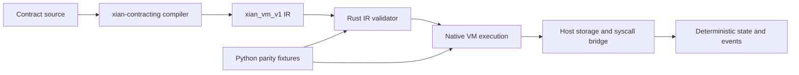

# xian-vm-core

`xian-vm-core` is the Rust-side consumer of the frozen `xian_vm_v1` compiler IR
emitted by `xian-compiler-core` through `xian-contracting`. It executes
contract calls for `xian-abci` through the native host bridge.

Supported scope:

- deserialize the structural JSON IR
- validate its top-level invariants and recursive node shapes
- instantiate validated modules and execute the supported contract language
- provide one Rust-owned contract for the Python frontend to target
- expose a minimal Python-facing native capability surface for `xian-abci`
  probing via `xian_vm_core._native`

Supported execution includes:

- local function calls and builtin calls such as `len`, `range`, `str`, and
  `isinstance`
- aggregate/container helpers such as `sorted`, `sum`, `min`, `max`, `all`,
  `any`, `reversed`, and `zip`
- explicit storage ops for `Variable` and `Hash`
- foreign storage reads for `ForeignVariable` and `ForeignHash`, including
  function-local references with dynamic contract/variable targets
- arbitrary-precision integer values instead of `i64`-only VM integers
- fixed-precision `decimal(...)` construction and arithmetic
- native `datetime.datetime` / `datetime.timedelta` values, including
  `datetime.datetime.strptime(...)`, arithmetic, comparison, and common field
  access
- bigint-oriented builtins needed by the shielded contracts, including
  `int(..., base)`, `pow(base, exp, mod)`, and `format(value, "064x")`
- explicit text/hex hashing: `hashlib.sha3_text(...)`, `sha3_hex(...)`,
  `sha256_text(...)`, and `sha256_hex(...)`
- `crypto.verify(...)` and `crypto.key_is_valid(...)`
- `LogEvent` emission
- static-import and dynamic-import contract export calls
- native container method calls used by contracts today, including
  `dict.keys()`, `dict.values()`, `dict.items()`, `dict.get()`, and the common
  mutable list helpers `append`, `extend`, `insert`, `remove`, and `pop`
- native string helpers used by the shielded contracts, including
  `lower()`, `isalnum()`, `startswith(...)`, and `join(...)`
- Python-style subscript slicing for `list`, `tuple`, and `str`, including
  the `value[2:]` helper pattern used in the shielded contracts
- sequence repetition for `list`, `tuple`, and `str`
- host-delegated `zk.*` syscalls, which remain explicit runtime boundary calls
  instead of Rust-local protocol logic

The node owns transaction authorization, nonce handling and account-registry
transitions. `crypto.verify` inside contracts is raw Ed25519 verification and
does not resolve current hybrid account authority; use authenticated callers
for account permissions.

The crate includes curated conformance fixtures generated from the current local
harness. Those fixtures are checked from Rust so the VM can match actual
contract behavior on a controlled contract subset alongside hand-written
executor tests.

Metering covers both host-side data costs and VM execution:

- storage reads, writes, transaction bytes, and return-value bytes are charged
  directly in the VM host path
- execution cost is driven by an explicit `xian_vm_v1` gas schedule over VM
  statements, expressions, calls, and loop iterations
- module initialization is metered, so first-load authored contracts do not get
  free global-declaration and module-body execution
- `contract.exists(...)`, `contract.has_export(...)`, `contract.info(...)`, and
  related contract metadata syscalls resolve directly against the driver/IR in
  the native host bridge
- authored contract storage persists `__xian_ir_v1__`, and the native host
  requires that validator-derived artifact for `xian_vm_v1` execution; stored
  `__source__` remains available for dashboards, BDS, and other inspection
  tooling
- native deployment accepts cleartext source only, rejects submitted
  `deployment_artifacts`, and derives `vm_ir_json` through the pinned compiler
  before staging writes
- native deployment requires explicit deterministic `now` context from the
  caller; the host does not fall back to local wall-clock time for submission
  metadata
- the native deployment path validates the compiler-produced IR before staging
  writes or executing constructors
- the Python deployment path and offline tooling keep canonical
  source-to-runtime recompilation in the Python artifact validator; the native
  path is Rust-native for bundle validation, not a Rust recompiler

That parity corpus covers:

- storage/event flows
- range/list/dict control-flow helpers
- foreign storage reads
- fixed-precision decimal semantics
- datetime/timedelta behavior
- bigint parsing, modular arithmetic, hex formatting, and shielded-style helper
  flows
- hashing and ed25519 verification helpers
- static-import and dynamic-import nested contract calls
- real authored shielded contract sources for `shielded-note-token` and
  `shielded-commands`, including constructor-seeded state snapshots and
  hash-helper exports
- real authored token, registry, game, and oracle flows across repos, including:
  `currency.transfer(...)`, `stable_token.burn(...)`,
  `reflection_token.transfer(...)`, `profile_registry.create_channel(...)`,
  `turn_based_games.join_match(...)`, and `oracle.price_info(...)`

## Python integration

The PyO3/maturin binding exposes:

- `runtime_info_json()` and `supports_execution_policy(...)`
- `validate_module_ir_json(...)`
- `validate_deployment_artifacts_json(...)`
- `execute_bundle(...)` with explicit context, host, transaction size and meter

Execution returns state changes, events, result/status and chi accounting.
The host supplies deterministic chain context and storage; consensus processing
commits the accepted results.

## Releases

Push a `vm-core-vX.Y.Z` tag with matching versions in `pyproject.toml` and
`Cargo.toml` after `../../scripts/validate-release.sh` passes. The release
workflow builds native wheels for Linux, macOS Intel/ARM and Windows, and a
source distribution. PyPI Trusted Publishing uses project `xian-tech-vm-core`,
owner `xian-technology`, repository `xian-contracting`, workflow `release.yml`
and environment `pypi-xian-vm-core`.

Runtime semantics are consensus-sensitive. Validators must use the same
accepted VM version; existing histories containing previously failed dynamic
foreign-storage calls need an explicit upgrade boundary.
